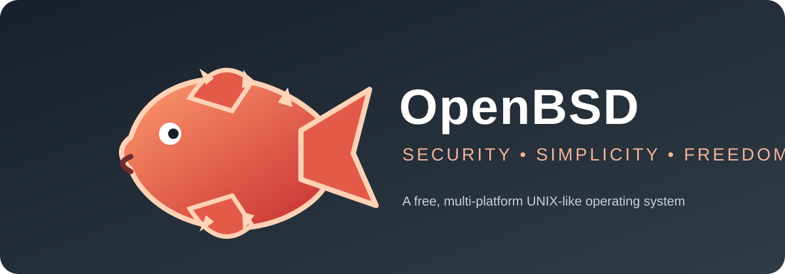
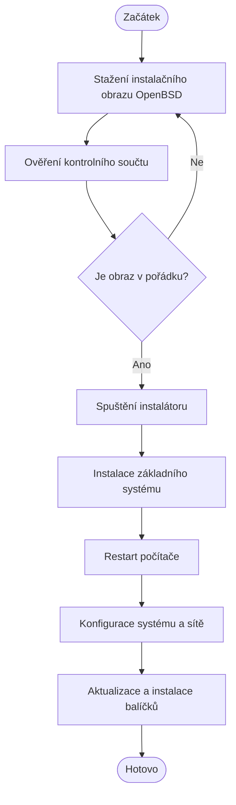

# OpenBSD – bezpečnost, jednoduchost a svoboda



**OpenBSD** je svobodný unixový operační systém známý především důrazem na bezpečnost, správnost kódu, přehlednost a kvalitní dokumentaci. Projekt vznikl v roce 1995 a jeho vývoj vede komunita kolem Theo de Raadta.

> *„Secure by default“ – bezpečnost není dodatečná funkce, ale jeden ze základních principů návrhu systému.*

## 1. Co je OpenBSD?

OpenBSD patří do rodiny operačních systémů BSD, která vychází z historického systému Unix. Je vyvíjeno jako samostatný projekt a nabízí kompletní systém včetně jádra, základních nástrojů, dokumentace a síťových služeb.

Mezi hlavní cíle projektu patří:

- **Bezpečnost:** důraz na bezpečné výchozí nastavení a průběžné bezpečnostní audity.
- **Správnost:** čitelný a konzistentní zdrojový kód.
- **Jednoduchost:** rozumně malé a srozumitelné základní prostředí.
- **Svobodná licence:** systém je šířen převážně pod licencemi typu ISC a BSD.

*OpenBSD se nesnaží být systémem pro každého. Upřednostňuje promyšlený návrh před množstvím funkcí.*

## 2. Architektura a komponenty

### 2.1 Jádro a uživatelský prostor

Jádro OpenBSD zajišťuje správu procesů, paměti, zařízení, souborových systémů a síťového provozu. Nad ním běží základní uživatelské nástroje, systémové démony a aplikace.

Důležitou vlastností je úzká integrace základního systému. Nástroje jako `ssh`, `pf` nebo `httpd` jsou vyvíjeny a udržovány v rámci projektu OpenBSD.

### 2.2 Bezpečnostní technologie

| Technologie | Účel |
|---|---|
| **pledge(2)** | Omezuje dostupné operace procesu. |
| **unveil(2)** | Omezuje přístup procesu k souborům a adresářům. |
| **W^X** | Zamezuje současné zapisovatelnosti a spustitelnosti paměťových oblastí. |
| **PF** | Stavový paketový filtr a firewall. |
| **doas** | Jednoduchý nástroj pro spouštění příkazů s právy jiného uživatele. |

### 2.3 Správa balíčků

OpenBSD používá nástroje `pkg_add`, `pkg_info` a `pkg_delete` pro práci s předkompilovanými balíčky. Základní systém a balíčky třetích stran jsou spravovány odděleně.

Příklad instalace editoru Vim:

```sh
# Aktualizace informací o balíčcích a instalace programu
doas pkg_add vim

# Zobrazení nainstalovaných balíčků
pkg_info
```

## 3. Praktická ukázka: kontrola systému

Následující Python skript vypíše základní informace o systému pomocí standardní knihovny. Python je zde pouze demonstrační nástroj; samotné OpenBSD je implementováno převážně v jazycích C a assembleru.

```python
import platform
import os

print("Operační systém:", platform.system())
print("Verze jádra:", platform.release())
print("Architektura:", platform.machine())
print("Počet CPU:", os.cpu_count())
```

## 4. Výhody a nevýhody

| Výhody | Nevýhody |
|---|---|
| Silný důraz na bezpečnost | Menší nabídka některého komerčního softwaru |
| Výborné manuálové stránky | Některý hardware nemusí být podporován |
| Přehledný základní systém | Menší ekosystém než u Linuxu |
| Integrovaný firewall PF | Vyžaduje ochotu učit se odlišnosti BSD |
| Konzistentní vývoj | Ne vždy nejvyšší výkon v každé úloze |

## 5. Matematický model dostupnosti

Dostupnost služby lze zjednodušeně vyjádřit jako podíl času, po který je služba funkční, ku celkovému sledovanému času:

$$
A = \frac{T_{provoz}}{T_{provoz} + T_{výpadek}} \times 100\,\%
$$

Kde:

- A je dostupnost v procentech,
- T (provoz) je doba, kdy služba funguje,
- T (výpadek) je doba, kdy služba nefunguje.

*Bezpečnostní mechanismy samy o sobě nezaručují stoprocentní dostupnost. Pomáhají však omezovat některé příčiny incidentů.*

## 6. Typický postup instalace a konfigurace

Následující diagram znázorňuje zjednodušený postup od získání instalačního obrazu po aktualizovaný systém.



## 7. Užitečné zdroje

- [Oficiální web OpenBSD](https://www.openbsd.org/) – informace o projektu a vydáních.
- [Oficiální FAQ](https://www.openbsd.org/faq/) – instalace, konfigurace a správa systému.
- [Manuálové stránky OpenBSD](https://man.openbsd.org/) – podrobná dokumentace příkazů, systémových volání a konfiguračních souborů.

## 8. Osobní To-Do list

- [x] Seznámit se s historií a filozofií OpenBSD.
- [x] Prozkoumat základní bezpečnostní technologie.
- [ ] Nainstalovat OpenBSD na fyzický počítač.
- [ ] Nakonfigurovat PF firewall.
- [ ] Vyzkoušet správu balíčků a aktualizace.
- [ ] Spustit vlastní službu pomocí OpenBSD `httpd`.

## Závěr

OpenBSD je zajímavou volbou pro uživatele, kteří chtějí pochopit unixové systémy do hloubky a oceňují bezpečnost, kvalitní dokumentaci a jednoduchý návrh. Hodí se například pro firewall, serverové nasazení, síťové experimenty i studium operačních systémů.
